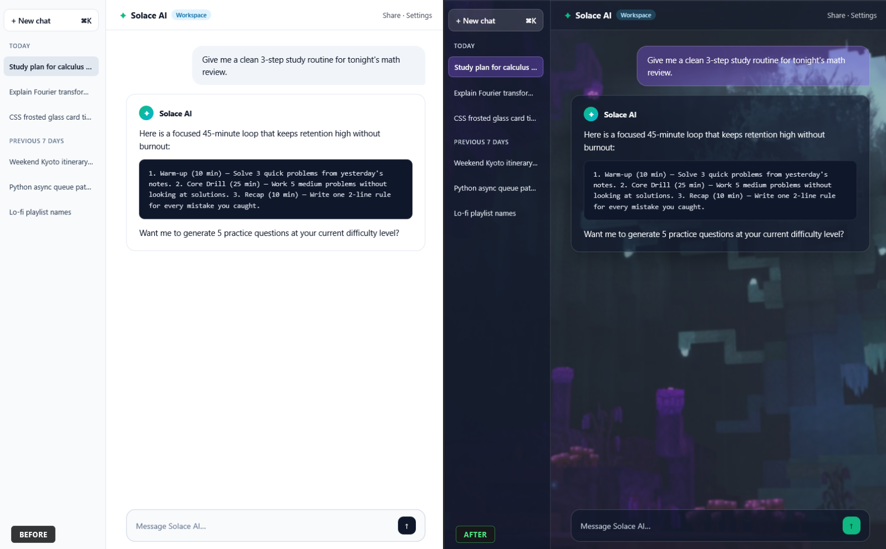
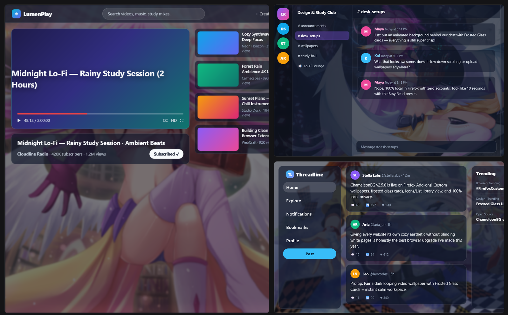
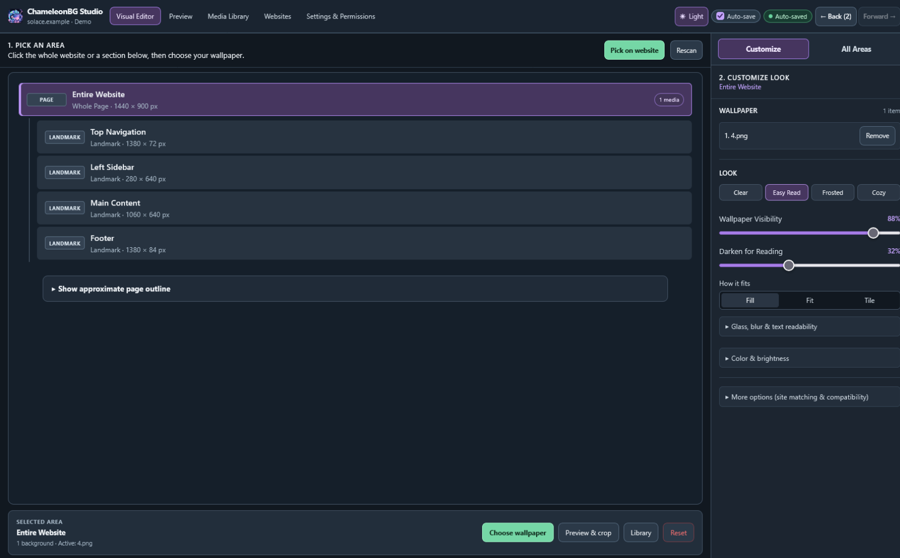
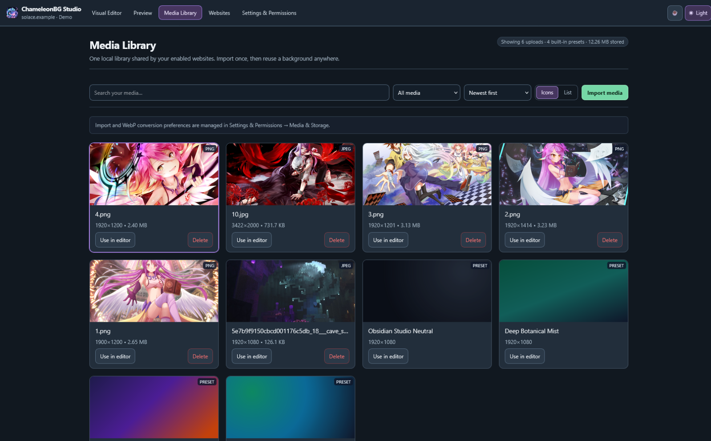
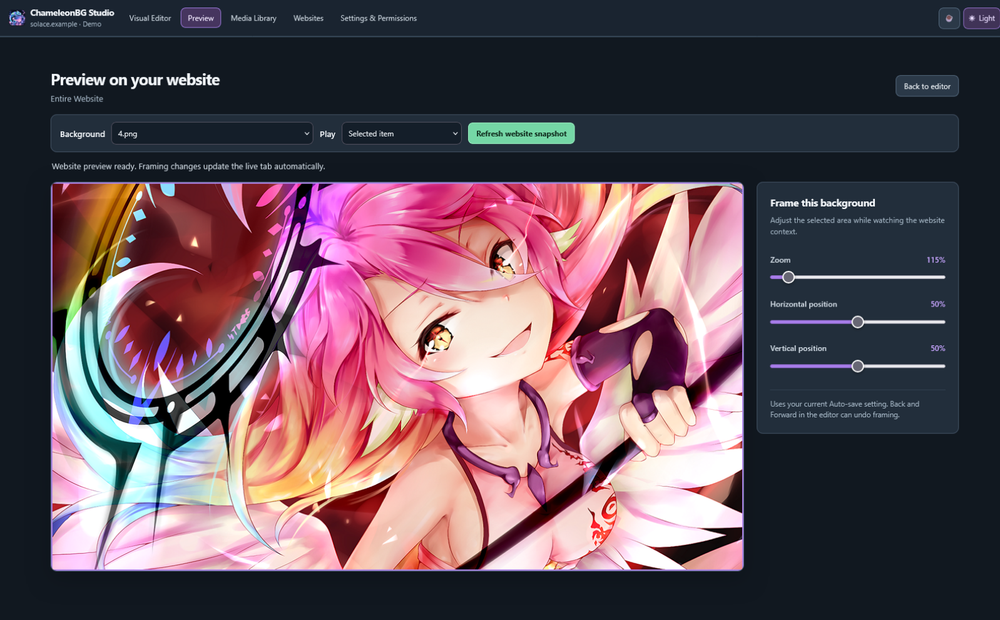

# ChameleonBG

**Add custom images, animated GIFs, sanitized SVGs, or looping video wallpapers to any website or specific sections of a page.**

[](https://addons.mozilla.org/en-US/firefox/addon/chameleonbg-custom-backgrounds/)
[](LICENSE)
[](PRIVACY.md)

ChameleonBG is a privacy-first browser extension with a full Visual Studio for personalizing websites. Everything stays locally in your browser with no accounts, no analytics, and no uploads.



## Screenshots

| View | Preview |
| --- | --- |
| **Per-Site Themes** |  |
| **Visual Editor** |  |
| **Media Library** |  |
| **Live Preview** |  |

---

## Install

### Firefox (Recommended)
Install the signed release directly from **[Firefox Add-ons (AMO)](https://addons.mozilla.org/en-US/firefox/addon/chameleonbg-custom-backgrounds/)**.

### Load from Source (Development)
1. Clone this repo or click **Code → Download ZIP** and extract it.
2. Open `about:debugging#/runtime/this-firefox` in Firefox.
3. Click **Load Temporary Add-on…** and select the root [`manifest.json`](manifest.json).

### Chrome / Chromium (Experimental)
An experimental Chromium manifest is available in [`browser-ports/`](browser-ports/README.md). Copy the repo folder, replace its root `manifest.json` with [`browser-ports/chromium/manifest.json`](browser-ports/chromium/manifest.json), and load it unpacked at `chrome://extensions`.

---

## How It Works (3 Steps)

1. Visit any `http://` or `https://` website, click the **ChameleonBG** toolbar icon, and click **Turn On for This Site**.
2. Open **Customize Look** to style the **Entire Website**, or click **Pick on website** (or right-click → **Choose area**) to target a specific section.
3. Choose a wallpaper from your computer or built-in presets, then pick a one-click look (**Clear**, **Easy Read**, **Frosted**, **Cozy**) or fine-tune the sliders.

---

## Features

- **Whole Page or Specific Areas:** Customize an entire site or pick individual sections (header, sidebar, main content, cards) using the live hover picker.
- **Images, GIFs, SVGs & Looping Videos:** Full support for static images, animated GIFs, sanitized SVGs, and smooth MP4/WebM video loops with automatic frozen-tail trimming.
- **Built for Readability:** One-click **Quick looks**, **Frosted Glass Cards**, reading dimmer, soft blur, text contrast boosts, and an experimental **Dynamic Invert** mode.
- **Playlists & Domain Themes:** Rotate multiple wallpapers on a schedule or reuse a single look across a domain and its subdomains.
- **Icons & List Media Library:** Import once, browse in **Icons** or **List** view, and reuse across any enabled website.
- **Non-Destructive & Safe:** Auto-save with Undo/Redo (`← Back` / `Forward →`), light & dark Studio modes, local backup/restore, and clean style restoration on reset.

---

## Development & Testing

ChameleonBG uses plain, readable JavaScript, HTML, and CSS with zero build step and zero runtime dependencies.

- **Unit Test Suite (39 tests):**
  ```bash
  node tests/unit_tests.js
  ```
- **Real Firefox E2E Browser Tests (5 tests, isolated temp profile):**
  ```bash
  node tests/firefox_e2e_tests.mjs
  ```
- **Build Mozilla AMO Upload Package:**
  ```bash
  python scripts/build_firefox.py
  ```

---

## Privacy, Contributing & Support

- **Privacy Policy:** Read [PRIVACY.md](PRIVACY.md) for a plain-English breakdown of local storage and every browser permission.
- **Contributing:** Bug reports, UX ideas, and pull requests are welcome! See [CONTRIBUTING.md](CONTRIBUTING.md).
- **Bug Reports & Support:** Open an issue on [GitHub Issues](https://github.com/Stella-Runcandel/Chameleon-BG-Extension/issues).
- **License:** [MIT License](LICENSE). Optional development support links are in Settings ([Ko-fi](https://ko-fi.com/stellalabs) · [Patreon](https://www.patreon.com/cw/Stella_Labs)); all features are free for everyone.
