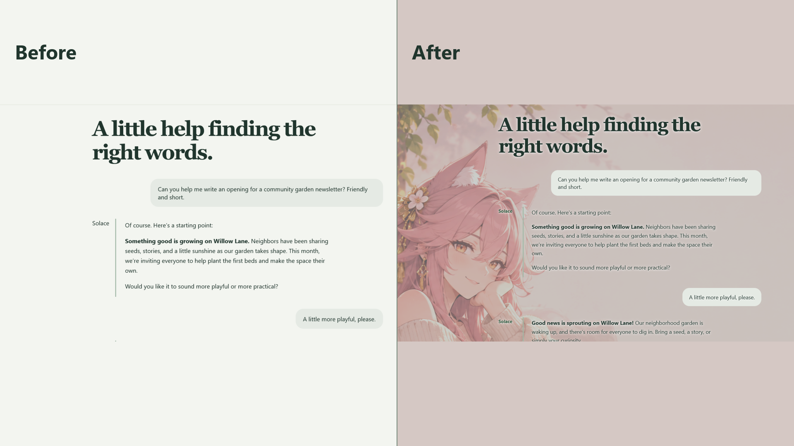

# ChameleonBG

ChameleonBG puts your own images, GIFs, sanitized SVGs, and looping videos behind a website or a selected part of one. Set it up in the Visual Editor, adjust the look, and keep different settings for different sites. Your media and settings stay in browser-owned local storage.

**Current release:** 2.4.0 for Firefox. A separate, experimental manifest for Chrome and other Chromium browsers is in [browser-ports](browser-ports/README.md).



The screenshots use **Solace**, a fictional local chat page. It does not connect to an AI service. The sample wallpaper is documentation media, not part of the extension install.

## Get it running

### Firefox

1. On GitHub, select **Code → Download ZIP**, then extract the repository. You can also clone it with Git.
2. In Firefox, open `about:debugging#/runtime/this-firefox`.
3. Select **Load Temporary Add-on** and choose the extracted repository's **root `manifest.json`**.
4. Open a normal HTTP or HTTPS page, select the ChameleonBG toolbar icon, and enable that site when prompted.

This temporary installation disappears when Firefox restarts. For a regular installation and automatic updates, use a signed release from Firefox Add-ons when available. The ZIP made by `scripts/build_firefox.py` is an **upload package for Mozilla**, not a signed add-on to install directly.

### Chrome

The Chromium port is **experimental** and has not had full browser-level verification. To try it without changing the Firefox source folder:

1. Download or clone this repository and make a separate copy of the extracted folder.
2. In that copy, replace the root `manifest.json` with [`browser-ports/chromium/manifest.json`](browser-ports/chromium/manifest.json). Keep the copied file named `manifest.json` at the extension root. No JavaScript or CSS files need replacing.
3. Open `chrome://extensions`, enable **Developer mode**, select **Load unpacked**, and choose the copied folder containing the replacement manifest.
4. Open a normal HTTP or HTTPS page and enable it from the ChameleonBG toolbar popup.

See [browser-ports](browser-ports/README.md) for Edge, Brave, Opera, Vivaldi, and the exact file changes. The Firefox manifest at the repository root remains the release source.

## First steps

1. Open the toolbar popup on a site you want to customize. Grant that site's browser permission and turn ChameleonBG on for it.
2. Select **Open Visual Editor**. Pick an area from the page hierarchy, or use **Select on site** or the page's **Choose area** menu item.
3. Import an image or video in **Media Library**, then assign it to the selected area. Built-in color presets are available without importing anything.
4. Use **Preview** to check the background against a captured view of the page and adjust zoom and position. The snapshot is a framing guide; refresh it after the page changes.
5. Adjust appearance, save a reusable Domain Theme if wanted, and use **Back** or **Forward** to undo or redo edits.

## What it can do

- Apply a background to the whole page or to a selected page region.
- Use images, animated GIFs, sanitized SVGs, looping videos, single media items, or rotating playlists.
- Tune opacity, brightness, contrast, saturation, blur, readability dimming, frosted glass, text contrast, fit, and framing.
- Control video playback, mute, volume, and loop points while respecting browser autoplay rules.
- Reuse local media across sites and use Domain Themes for a base domain and its subdomains.
- Manage site access, auto-save, undo and redo, light and dark Studio themes, and local backup and restore.

## Screenshots

| View | What it shows |
| --- | --- |
| [Before and after](docs/screenshots/01-before-after.png) | A working demonstration of a custom background on the fictional Solace page. |
| [Visual Editor](docs/screenshots/02-visual-editor.png) | Page hierarchy, selected area, and assignment controls. |
| [Framing Preview](docs/screenshots/03-framing-preview.png) | A website snapshot beside zoom and position controls. |
| [Media Library](docs/screenshots/04-media-library.png) | Imported media and built-in presets. |
| [Finished page](docs/screenshots/05-demo-result.png) | The resulting background behind the chat page. |

The [sample wallpaper](docs/demo-media/cozy-fox-spirit-reading-lounge.png) is supplied for documentation. It is not required to use ChameleonBG and is excluded from the Firefox upload package. The MIT license below covers the extension source; do not assume it grants separate rights to reuse the sample artwork.

## Privacy, permissions, and limits

ChameleonBG stores imported media and site settings locally in browser-managed storage. It has no developer account, analytics, or media upload service. The toolbar asks for HTTP/HTTPS site access when you choose to enable a site; it does not need to alter every site you visit. **Preview** may capture the visible tab locally to show the page in the Studio. [PRIVACY.md](PRIVACY.md) explains each browser permission, data storage, and removal controls.

Browser-protected pages, some embedded frames, and closed shadow roots cannot be customized. The extension does not bypass DRM or a site's rules; use media you have permission to use and check the rules of sites you customize.

## Build and check the Firefox release

The extension uses readable source files with no runtime package manager or remote executable code. For a Mozilla upload, Python 3.8 or newer creates `dist/chameleonbg-2.4.0-firefox-upload.zip`:

```text
python scripts/build_firefox.py
```

Run the unit suite with Node.js:

```text
node tests/unit_tests.js
```

The Firefox upload ZIP excludes tests, demo pages, screenshots, browser-port guides, and other development files.

## License and support

The extension source is under the [MIT License](LICENSE). If you want to support development, the optional Settings links open [Ko-fi](https://ko-fi.com/stellalabs) and [Patreon](https://www.patreon.com/cw/Stella_Labs); support does not unlock features.
